<picture>
  <source media="(prefers-color-scheme: light)" srcset="assets/banner-light.svg">
  
</picture>

  
  
  
  

Fullstack developer and automation engineer from Caracas, working remotely with teams in Canada and Spain. I build ERPs, dealer websites and internal tools, and the automations that connect them, so work gets done without anyone remembering to do it.

 

<picture>
  <source media="(prefers-color-scheme: light)" srcset="assets/h-build-light.svg">
  
</picture>

<picture>
  <source media="(prefers-color-scheme: light)" srcset="assets/services-light.svg">
  
</picture>

 

<picture>
  <source media="(prefers-color-scheme: light)" srcset="assets/timeline-light.svg">
  
</picture>

 

<picture>
  <source media="(prefers-color-scheme: light)" srcset="assets/h-stack-light.svg">
  
</picture>

  <picture>
    <source media="(prefers-color-scheme: light)" srcset="https://skillicons.dev/icons?i=laravel,php,vue,react,nextjs,angular,ts,wordpress,tailwind,mysql,postgres,supabase,python,threejs,git&theme=light&perline=15">
    
  </picture>

  
  
  
  
  
  
  
  

 

<picture>
  <source media="(prefers-color-scheme: light)" srcset="assets/h-numbers-light.svg">
  
</picture>

  <picture>
    <source media="(prefers-color-scheme: light)" srcset="https://github-readme-stats.vercel.app/api?username=andresmarquez02&show_icons=true&hide_border=false&bg_color=ffffff&title_color=1e1e2a&text_color=363644&icon_color=188554&border_color=dddde5&border_radius=14&count_private=true">
    
  </picture>
  <picture>
    <source media="(prefers-color-scheme: light)" srcset="https://github-readme-stats.vercel.app/api/top-langs/?username=andresmarquez02&layout=compact&bg_color=ffffff&title_color=1e1e2a&text_color=363644&border_color=dddde5&border_radius=14&langs_count=8">
    
  </picture>

  <picture>
    <source media="(prefers-color-scheme: light)" srcset="https://streak-stats.demolab.com?user=andresmarquez02&background=ffffff&border=dddde5&stroke=dddde5&ring=188554&fire=188554&currStreakNum=1e1e2a&sideNums=1e1e2a&currStreakLabel=1e1e2a&sideLabels=696976&dates=9d9da8&border_radius=14">
    
  </picture>

Most of my client work lives in private repositories. <a href="https://andresmarquez.site">The portfolio</a> walks through it: problem, solution and result.

